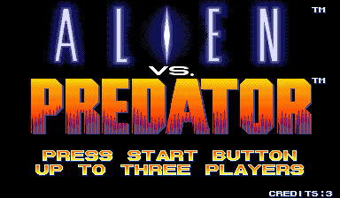
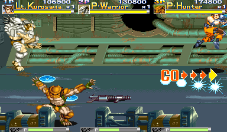
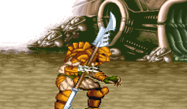

# Alien vs. Predator Recomp

> Part of **[CPS-2 Recomp](../../README.md)**: one download and one launcher for every Capcom arcade game this
> project has ported. This page is about Alien vs. Predator; the [main page](../../README.md) says how to download
> and play.

An unofficial native PC port of the arcade game *Alien vs. Predator* (Capcom, 1994, CPS-2 board) for macOS, Linux
(Steam Deck included) and Windows, made by static recompilation: a beat-'em-up for up to three players, with free
play, a round to start at, a score attack, viewers for its stages and characters, the board's own settings and cheats.

> **Beta.** The game plays through its first rounds in made-up play and its code is checked instruction by instruction, but
> nobody has played it by hand yet. Expect rough edges, and please [report what you find](#feedback-and-contributing).

**No game files are included.** You need your own copy of the game: the arcade ROM set `avspu` (USA, 940520) with its
key file, from a board you own. This project cannot help you get one.

This project is not affiliated with, endorsed by, or sponsored by Capcom or 20th Century Studios. *Alien vs. Predator*
is a trademark of its owners.




## What it is

The game's 68000 program is translated ahead of time into C++ and compiled into the port, and so is its sound
program; what the program expects of the board is code written for this project, not an emulator.

- **Three players at once**, each with a keyboard layout or a gamepad of their own. The board as it left the
  factory takes two; the Board page's **Players** setting lets a third join (on in Enhanced): three sharing one coin
  chute, or each with a chute of their own.
- Plays with a keyboard, a gamepad or an arcade stick; every key and button can be changed, for each player, in the
  launcher, where the buttons are called what the game calls them: **Attack**, **Jump** and **Shoot**. On a gamepad
  they start on X, Y and the right shoulder, as the collection's other games have their first three buttons (in the
  game's own launcher: X, A and B).
- An in-game menu (Esc or `F1`; on a gamepad, the left stick's click or Start and Select together) with save states,
  speed, pause and frame advance, the cheats and every feature.
- **Pure** plays exactly as the board does. **Enhanced** (the default) adds free play and the third player. Every
  other feature is a switch of its own.
- **Start at round**: a new game starts at the beginning of any of the seven rounds.
- **Alternative modes**, at the head of the in-game menu:
  - **Attract mode**: the game's own show on a loop, with its sound on: all of it, or only the story, only the
    demonstration fights, or only the characters' files and how to play them.
  - **Score attack**: one player and one credit from round 1, no continue and no cheats, for the best score, which
    is kept.
  - **Stage viewer**: each of the rounds' scenes with nobody on it, only the scenery and its music, scrolled with
    the stick or by itself (slow, medium, fast), or every scene in turn.
  - **Character viewer**: the Predator Warrior, Dutch Schaefer, the Predator Hunter or Linn Kurosawa by themselves,
    on a scene or on white or black, from a quarter of their size to 25 times, moved with your controls or going
    through any of their animations, in slow motion if you like.
- **Custom soundtrack**: your own music files in place of the board's music ([how](../../README.md#a-custom-soundtrack));
  the game names its pieces in `songs.txt` (each round's music, the bosses', player select, the results, continue).
- **Rapid fire**: a button held down is pressed again and again, for the first button (Attack) or for all of them.
- **Cheats**: infinite health, infinite lives and infinite time (the round's clock stands still), for every player.
- The board's operator settings on the Board page (players, difficulty 1-8, extend, lives at the start and after a
  continue, continue, demo sound), each as the board is set unless you choose; or the game's own test menu from the
  in-game menu.
- **Straight to the title**: at a start or a reset, the board's start, the notices and the story run unseen.
- The picture your way (Display page): sharp, whole pixels or smooth; 4:3, square pixels or the whole screen; and
  the window's size. Run-ahead takes a frame or two of input lag away.
- Your ROM set is only ever read. Settings, save states and the board's settings memory go in your own user folder.





## What you need

- The ROM set `avspu` (*Alien vs. Predator*, USA 940520): `avspu.zip` (with `avsp.zip` beside it, if your collection
  keeps the shared files there) or a folder with the set's files, including `avspu.key`. The launcher checks every
  file by checksum and tells you which is missing or different. Some older collections have the set without its key
  file, or with older dumps of four graphics ROMs (`avp.14m`, `16m`, `18m`, `20m`): those will not do.
- One of: macOS 13 or later (Apple silicon or Intel); Linux x86_64 or SteamOS; Windows 10 or 11, 64-bit.
- For three players: three gamepads, or keys chosen for the second and third players on the Controllers page.

## Playing

Alien vs. Predator comes with [CPS-2 Recomp](../../README.md#playing): open its launcher and show it your ROM set
(drop `avspu.zip` or its folder on the window, or choose the folder you keep your sets in), then press **Play** beside
Alien vs. Predator. From a terminal, `cps2recomp-launcher --play avsp` starts it straight away; the game's own program
(`avsp`, beside the launcher) runs by itself too: `avsp --help` lists what it takes.

## Building from source

With your own ROM set in `rom/avsp/` (ignored by Git), from the repository's top:

```sh
make GAME=avsp            # twice the first time
make GAME=avsp explore    # once: finds the game's code by made-up play and translates it
make GAME=avsp run
make GAME=avsp check
```

[PROGRESS.md](PROGRESS.md) has what was found of the game; [docs/BUILDING.md](../../docs/BUILDING.md) has every
platform.

## Feedback and contributing

Bug reports and pull requests are welcome: see [CONTRIBUTING.md](../../CONTRIBUTING.md) for the rules (above all:
nothing from the game, ever).

## License and credits

GPL-3.0-only (see [LICENSE](../../LICENSE)); [THIRD_PARTY_NOTICES.md](../../THIRD_PARTY_NOTICES.md) lists what comes
from other projects. The repository holds no game data: the names header's addresses are numbers.
