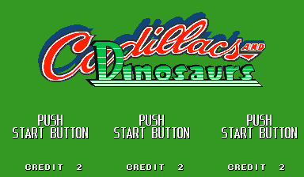
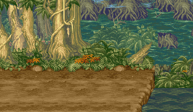

# Cadillacs and Dinosaurs Recomp

> Part of **[CPS-2 Recomp](../../README.md)**: one download and one launcher for every Capcom arcade game this
> project has ported. This page is about Cadillacs and Dinosaurs; the [main page](../../README.md) says how to
> download and play.

An unofficial native PC port of the arcade game *Cadillacs and Dinosaurs* (Capcom, 1993, CPS-1 board with QSound)
for macOS, Linux (Steam Deck included) and Windows, made by static recompilation: a beat-'em-up for up to three
players, with free play, a stage to start at, a score attack, viewers for its stages and characters, the board's own
settings and cheats. It is the first game here from the
CPS-2's older brother, the CPS-1.

> **Beta.** The game plays through its first stages in made-up play and its code is checked instruction by instruction, but
> nobody has played it by hand yet, and its sound has not been listened to. Expect rough edges, and please
> [report what you find](#feedback-and-contributing).

**No game files are included.** You need your own copy of the game: the arcade ROM set `dino` (World, 930201), from a
board you own. This project cannot help you get one.

This project is not affiliated with, endorsed by, or sponsored by Capcom or Mark Schultz. *Cadillacs and Dinosaurs*
is a trademark of its owners.




## What it is

The game's 68000 program is translated ahead of time into C++ and compiled into the port, and so is its sound
program. What the program expects of the board is code written for this project, not an emulator: the CPS-1's
video (its objects among the scroll screens, as its layer control orders them), its inputs for three players, its
settings memory and QSound.

The board's sound CPU deciphers its program as it reads it (Capcom's Kabuki chip), and no ROM set carries its key.
The port works the key out from your own ROM when it loads it, from how Capcom's sound program always starts, in
about a second. No key is in this repository.

- **Three players at once**, each with a keyboard layout or a gamepad of their own (the board as it left the factory
  takes three, each with a coin chute).
- Plays with a keyboard, a gamepad or an arcade stick; every key and button can be changed, for each player, in the
  launcher, where the buttons are called what the game calls them: **Attack** and **Jump** (both together: the
  special attack). On a gamepad they start on X and Y, as the collection's other games have their first two buttons
  (in the game's own launcher: X and A).
- An in-game menu (Esc or `F1`; on a gamepad, the left stick's click or Start and Select together) with save states,
  speed, pause and frame advance, the cheats and every feature.
- **Pure** plays exactly as the board does. **Enhanced** (the default) adds free play. Every other feature is a
  switch of its own.
- **Start at stage**: a new game starts at the beginning of any of the eight stages.
- **Alternative modes**, at the head of the in-game menu:
  - **Attract mode**: the game's own show on a loop, with its sound on: all of it, or only the story (the opening
    and the dinosaurs' attack), only the demonstrations, or only the characters' files.
  - **Score attack**: one player and one credit from the first episode, no continue and no cheats, for the best
    score, which is kept.
  - **Stage viewer**: each part of each episode with nobody on it, only the scenery and its music, scrolled with the
    stick or by itself (slow, medium, fast), up and down where the episode climbs or falls, or every part in turn.
  - **Character viewer**: Jack, Mustapha, Hannah or Mess by themselves, on a stage or on white or black, from a
    quarter of their size to 25 times, moved with your controls or going through any of their animations, in slow
    motion if you like.
- **Custom soundtrack**: your own music files in place of the board's music ([how](../../README.md#a-custom-soundtrack));
  the game names its pieces in `songs.txt` (each kind of place's music, the bosses', the episodes' maps, continue).
- **Rapid fire**: a button held down is pressed again and again, for the first button (Attack) or for both.
- **Cheats**: infinite health, infinite lives and infinite time (the stage's clock stands still), for every player.
- The board's operator settings on the Board page (difficulty, difficulty 2, extend, lives, continue, demo sound),
  each as the board is set unless you choose; or the game's own test menu from the in-game menu.
- **Straight to the title**: at a start or a reset, the board's start, its version and its warning run unseen.
- The picture your way (Display page): sharp, whole pixels or smooth; 4:3, square pixels or the whole screen; and
  the window's size. Run-ahead takes a frame or two of input lag away.
- Your ROM set is only ever read. Settings, save states and the board's settings memory go in your own user folder.




## What you need

- The ROM set `dino` (*Cadillacs and Dinosaurs*, World 930201): `dino.zip` or a folder with the set's files. It has
  no key file. The launcher checks every file by checksum and tells you which is missing or different.
- One of: macOS 13 or later (Apple silicon or Intel); Linux x86_64 or SteamOS; Windows 10 or 11, 64-bit.
- For three players: three gamepads, or keys chosen for the second and third players on the Controllers page.

## Playing

Cadillacs and Dinosaurs comes with [CPS-2 Recomp](../../README.md#playing): open its launcher and show it your ROM set
(drop `dino.zip` or its folder on the window, or choose the folder you keep your sets in), then press **Play** beside
Cadillacs and Dinosaurs. From a terminal, `cps2recomp-launcher --play dino` starts it straight away; the game's own
program (`dino`, beside the launcher) runs by itself too: `dino --help` lists what it takes.

## Building from source

With your own ROM set in `rom/dino/` (ignored by Git), from the repository's top:

```sh
make GAME=dino            # twice the first time
make GAME=dino explore    # once: finds the game's code by made-up play and translates it
make GAME=dino run
make GAME=dino check
```

[PROGRESS.md](PROGRESS.md) has what was found of the game; [docs/TOOLKIT.md](../../docs/TOOLKIT.md) has the CPS-1
board; [docs/BUILDING.md](../../docs/BUILDING.md) has every platform.

## Feedback and contributing

Bug reports and pull requests are welcome: see [CONTRIBUTING.md](../../CONTRIBUTING.md) for the rules (above all:
nothing from the game, ever).

## License and credits

GPL-3.0-only (see [LICENSE](../../LICENSE)); [THIRD_PARTY_NOTICES.md](../../THIRD_PARTY_NOTICES.md) lists what comes
from other projects. The repository holds no game data and no key: the names header's addresses are numbers, and the
sound program's key is worked out from the player's own ROM.
