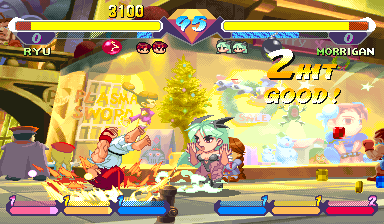
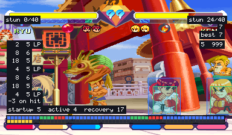
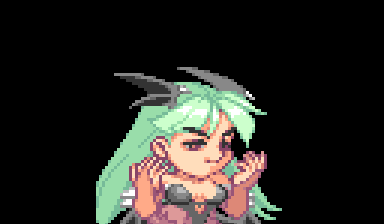
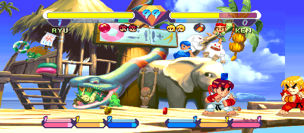

# Super Gem Fighter Mini Mix Recomp

> Part of **[CPS-2 Recomp](../../README.md)**: one download and one launcher for every CPS-2 game this
> project has ported. This page is about Super Gem Fighter Mini Mix (*Pocket Fighter* in Japan); the
> [main page](../../README.md) says how to download and play.

An unofficial native PC port of the arcade game *Super Gem Fighter Mini Mix* (*Pocket Fighter*; Capcom, 1997,
CPS-2 board) for macOS, Linux (Steam Deck included) and Windows, made by static recompilation.

It has everything the other fighting games here have: a full **training mode** (hit boxes, frame data and a frame
meter, input display, combo and stun readouts, a dummy that records, replays and guards), the **alternative modes**
(attract mode, the stage and model viewers, survival, endless battle, ring out), **widescreen**, **custom colours**
with a colour editor, the **hidden characters** with no code, and the features every game shares: free play, straight
to the title, the board's operator settings, cheats, save states, run-ahead, arcade timing, a custom soundtrack.

> **Beta.** The game plays from start to ending and its code is checked instruction by instruction, but it has
> been played on few machines and controllers yet. Expect rough edges, and please
> [report what you find](#feedback-and-contributing).

**No game files are included.** You need your own copy of the game: the arcade ROM set `sgemf` (USA, 970904)
with its key file, from a board you own. **Only that version works.** This project cannot help you get one.

This project is not affiliated with, endorsed by, or sponsored by Capcom. *Super Gem Fighter* and *Pocket Fighter*
are trademarks of Capcom Co., Ltd.






## What it is

The game's 68000 program is translated ahead of time into C++ and compiled into the port, and so is its sound
CPU's (Capcom's sound driver 1.30). The routines widescreen changes (the camera's place and keeping the players inside
the picture) are rewritten by hand as readable C++, each checked call by call against the game's own code. What the
program expects of the board (its video, the QSound chip, the sound CPU and its registers, the settings memory) is code
written for this project, not an emulator. Every translated block is checked against an interpreter of the same
program ([how it was made](PROGRESS.md)).

- Plays with a keyboard, a gamepad or an arcade stick; every key and button can be changed, for each player, in
  the launcher. The game has three buttons: Punch, Kick and Special.
- An in-game menu (Esc or `F1`; on a gamepad, the left stick's click or Start and Select together) with the
  training mode and the other modes, save states, speed, the cheats and every feature.
- **Rapid fire** (Game page): a button held down is pressed again and again, fifteen times a second, for the first
  button or for all of them; the first press is seen at once.
- **Pure** plays exactly as the board does. **Enhanced** (the default) adds free play (the game's own, one of the
  board's coin settings, so the screen says FREE PLAY) and your own [character colours](#custom-colours). Every other
  feature is a switch of its own.
- **Straight to the title** (Game page): at a start or a reset, everything before the title (the board's start,
  the warning, the notices and the introduction) runs unseen; with a coin in, the picture comes back with the title
  that asks for Start.
- The board's operator settings (difficulty, damage level, timer speed, game speed, rounds and the rest) on the
  Board page (launcher's Features, in-game menu), each as the board is set unless you choose; or the game's own
  test menu from the in-game menu.
- Cheats: no damage (each player), one-hit knockouts, infinite time.
- **Hidden characters** (Game page): Akuma and Dan with no code. Hold Start as you choose Ryu for Akuma, or Ken for
  Dan; the button still chooses the colours.
- **Arcade timing** (Game page, off unless chosen): the processor run as on the arcade board, so the game slows
  down where and as much as the board does. [More →](../../docs/TIMING.md)
- **Run-ahead** (Game page): what you press seen a frame or two sooner than on the board, with the game running
  exactly as without it.
- **A custom soundtrack**: your own music in place of the board's, with the board's sound effects and voices: a
  folder of music plays as a playlist (in order or shuffled), or files named for the game's songs replace those
  songs. The `songs.txt` the game writes in the soundtrack folder names the music: each stage's, player select,
  versus, the winner's, the story, the ending, the staff roll, the rankings and the notices.
  [How →](../../README.md#a-custom-soundtrack)
- Your ROM set is only ever read. Settings, save states and the board's settings memory go in your own user folder.

## Training mode

"Alternative modes" at the top of the in-game menu has a Training mode page: Start goes straight to the character
choice with two players (player 1's controls choose for both) and into a fight with no clock that nobody loses, and
the page holds the aids below.

| Feature | What it does |
| --- | --- |
| Hit boxes | The boxes the game itself tests: where a player can be hit (blue), attacks (red; orange for things thrown), pushing boxes (green) |
| Frame data and frame meter | Startup, active and recovery of each move and the advantage after a hit or a guarded hit, counted in the game's own steps; a row of cells for each player, one a step; optionally every move written to `frame_data.csv` beside the settings |
| Input display | What each player presses and for how long, in numpad notation from the player's side |
| Combo readout | Hits and damage of a combo, the round's best |
| Stun readout | How much stun each player has built up, against how much stuns them |
| Health and gauge refills | Health comes back when a player has not been hit for a moment; both super gauges kept full |
| The dummy | Stands, crouches, jumps; guards (always, after a hit, at random); records and replays in three slots (one, or any at random), and can answer with a recording after guarding or being hit |
| Start over | The round as it began, in the middle or a corner, sides swapped or not (Backspace, or a gamepad's left shoulder) |
| Stage | Any of the eight stages, or the game's own choice |
| Stop, step, slow | Stop the game, go on a frame at a time, or play at a half, a quarter or an eighth of the speed |

A jab's frame data, for one: startup 5, active 4, recovery 17.

## Alternative modes

The in-game menu's first row, "Alternative modes", has ways of playing and watching the game that the board does not
have. Each has a page with a Start row and its own choices, and runs until another is started or the menu's Reset.

| Mode | What it does |
| --- | --- |
| Training mode | A fight with no clock that nobody loses, and the aids above |
| Attract mode | The game's own show on a loop: everything, the introduction only, or one demonstration fight after another |
| Stage viewer | Any of the eight stages with nobody on it and no panel, scrolled with the stick or by itself, with any tune; "Infinite" scrolls through every stage in turn |
| Model viewer | One character by itself, on a stage or on plain white or black, from a quarter of its size to 25 times. It stands and moves with your controls, or goes through any of its animations (named A0, B12, C3... as the game's own lists number them; left and right step through them), over and over or all of them one after another (Play all), at full speed or in slow motion |
| Colour editor | Change a character's colours while you watch: [custom colours](#custom-colours) |
| Survival | One computer opponent after another on the health you have left. How many can you beat? |
| Endless battle | Two fighters the game plays, for as long as you like, with no bars and no clock, on one stage, on stages that fade one into another, or on a floor that scrolls through them all. Touch the controls to take a fighter over |
| Ring out | No health. Knock your opponent over the end of the stage (it is thrown into the air, as by a knock-down, and falls through the floor), then jump down after it and land on the next stage |



## Widescreen



A switch on the launcher's first page, under "Full screen" (and on the in-game menu's Display page). Fights are shown
and played in 16:9: the picture is 512 columns wide where the board's is 384, at the same height and with everything
the same size, so there is a third more of the stage in view.

It is **off unless you switch it on**, in every preset, because it changes how the game plays:

- The players can go to the wide picture's edges, so they can stand further apart than on the board. The stage's own
  ends are where they were.
- The camera stops 64 short of where it did, so that the picture ends where the stage does.
- The bars and the gauges stay in the middle. Everything that is not a fight keeps the board's 4:3.

With it off the game is exactly the board's. Nothing here stretches the picture: the extra columns are the game's own
stage art, which the board already holds and never showed, and on all eight stages they are painted to the camera's
ends.

**Invisible walls**, on the Display page, keeps the 16:9 picture and plays the game exactly as the board does: the
players are stopped where the board's picture ends, by walls that are not seen, and the camera goes as far as the
board's. Near a stage's end the view stays on the stage, so the play area is then to one side of the wide picture. The
game's memory is the same as with widescreen off, frame for frame (`make GAME=pocket_fighter check-widescreen`
compares it along the ladder).

## Custom colours

Give any character colours of your own: change them in the game's colour editor (Alternative modes), or bring files
someone else made.

- **The colour editor** shows the character with a panel at the right, worked with player 1's controls: the
  character, background, size and animation; the **set** (by the button that chooses the character: Punch (P), Kick
  (K), Special (S), or two at once (PK)); the **line** (the character's own colours, or one of four lines for its
  effects); each colour's red, green and blue; random colours; saving a set to the character's library and loading
  it into any set. Changes show at once and are saved as you go. To play in them, choose the character with the
  button of the set you changed.
- **Files**: `palettes/<Character>.txt` in the game's data folder (one section a set, a line of 16 colours a
  palette), or a `pcf.07` changed with PalMod. "Write the game's colours" writes the game's own to start from.

## The board's settings

The Board page has nine settings of the test menu's Configuration, each "As the board is set" unless chosen.
A choice is what the test menu would have set; the board's settings memory itself is not changed, and the test
menu shows the board's own values.

| Setting | Choices | The board's own (a new board) |
| --- | --- | --- |
| Difficulty | Easy, Normal, Hard 1 to 5, Expert | Hard 3 |
| Damage level | Low, Normal, High, Maximum | Normal |
| Timer speed | Slow, Normal, Fast, Fastest | Slow |
| Game speed | Turbo 1 to 4, Free select | Free select |
| Max round | 1, 3 or 5 rounds | 3 rounds |
| Event | Off, one match (and no continue) | Off |
| Join-in | Off, On (a second player can join a game against the computer) | On |
| Continue | Off, On | On |
| Demo sound | Off, On | On |

## What you need

- The ROM set `sgemf` (*Super Gem Fighter: Mini Mix*, USA 970904): `sgemf.zip` or a folder with the set's files,
  including `sgemf.key`. The launcher checks every file by checksum and tells you which is missing or different.
  Sets of other regions are refused (`pfghtj`, the Japanese *Pocket Fighter*, among them): the port is made from
  this one version's program, and its features use addresses found in it.
- One of: macOS 13 or later (Apple silicon or Intel); Linux x86_64 or SteamOS; Windows 10 or 11, 64-bit.
- A gamepad or stick with three buttons or more is recommended (and one more for Start, for the hidden characters).

## Playing

Super Gem Fighter Mini Mix comes with [CPS-2 Recomp](../../README.md#playing): open its launcher and show it your ROM
set (drop `sgemf.zip` or its folder on the window, or choose the folder you keep your sets in), then press **Play**
beside Super Gem Fighter Mini Mix. From a terminal, `cps2recomp-launcher --play pocket_fighter` starts it straight
away; the game's own program (`pocket_fighter`, beside the launcher) runs by itself too: `pocket_fighter --help`
lists what it takes.

While playing, Esc or `F1` (on a gamepad, the left stick's click, or Start and Select together) opens the in-game
menu. Only the menu's "Quit game" row (or closing the window) ends the game.

## Building from source

With your own ROM set in `rom/pocket_fighter/` (ignored by Git), CMake, Ninja, SDL 3 and Python 3,
from the repository's top:

```sh
make GAME=pocket_fighter            # twice the first time
make GAME=pocket_fighter explore    # once, about five minutes: finds the game's code by made-up play and translates it
make GAME=pocket_fighter run
make GAME=pocket_fighter check FRAMES=40000 MOVIE=games/pocket_fighter/movies/ladder.txt
```

[docs/BUILDING.md](../../docs/BUILDING.md) has every platform, the checks and the release builds, and
[PROGRESS.md](PROGRESS.md) what was found about the game and what is next.

## Feedback and contributing

Bug reports and pull requests are welcome: see [CONTRIBUTING.md](../../CONTRIBUTING.md) for the rules (above all:
nothing from the game, ever).

## License and credits

GPL-3.0-only (see [LICENSE](../../LICENSE)); [THIRD_PARTY_NOTICES.md](../../THIRD_PARTY_NOTICES.md) lists what comes
from other projects. The repository holds no game data and nothing derived from it.
