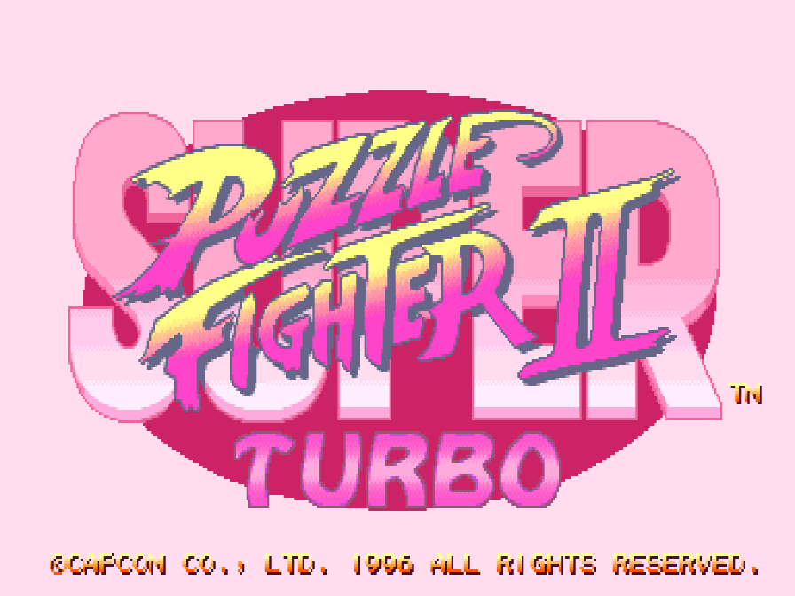
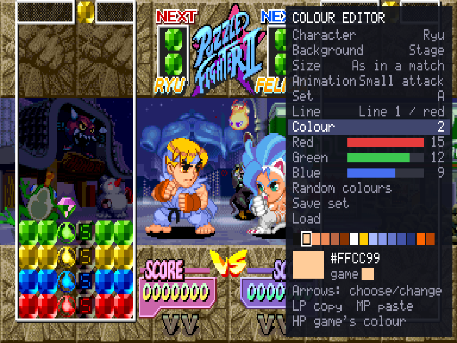
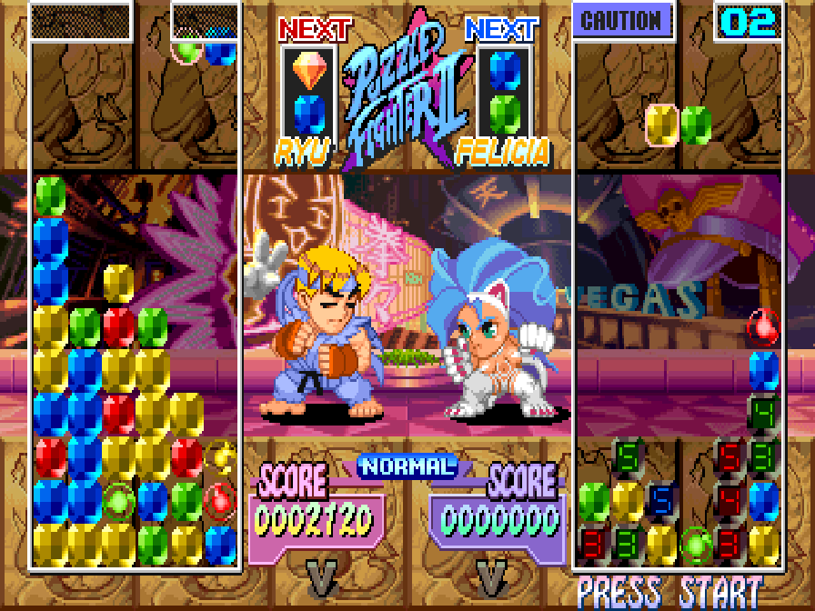
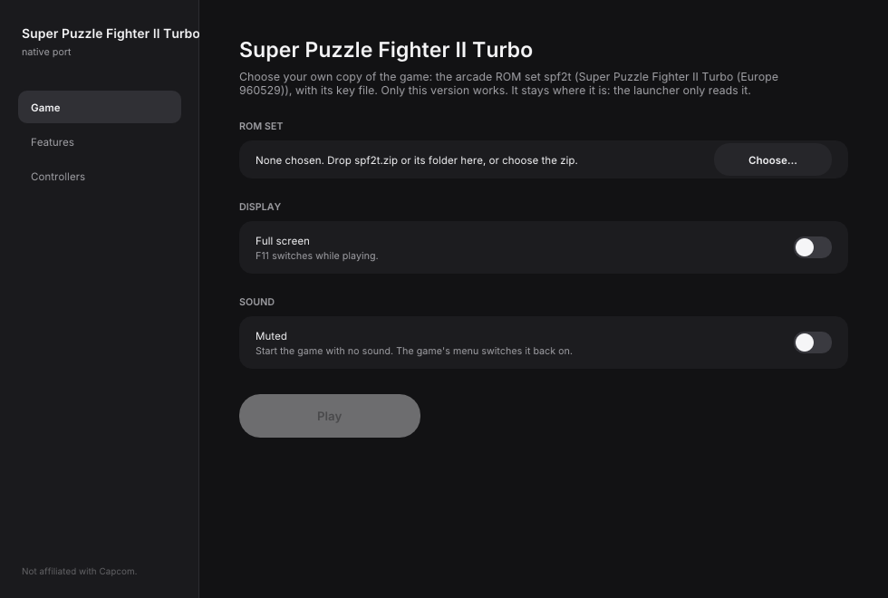
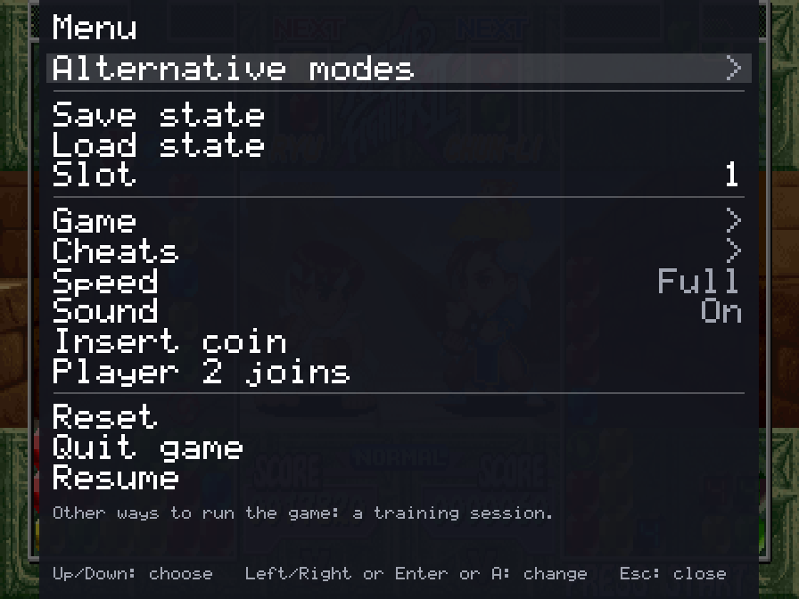
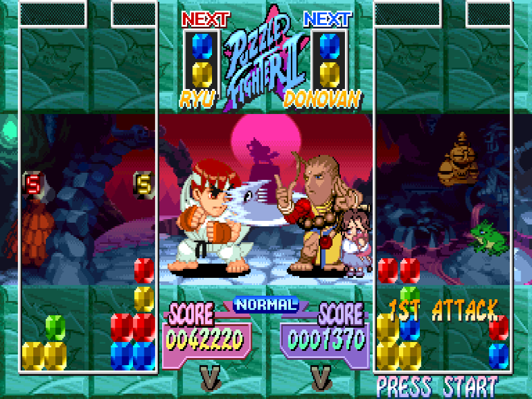

# Super Puzzle Fighter II Turbo Recomp

> Part of **[CPS-2 Recomp](../../README.md)**: one download and one launcher for every CPS-2 game this
> project has ported. This page is about Super Puzzle Fighter II Turbo; the [main page](../../README.md) says how to
> download and play.

An unofficial native PC port of the arcade game *Super Puzzle Fighter II Turbo* (Capcom, 1996,
CPS-2 board) for macOS, Linux (Steam Deck included) and Windows, made by static recompilation, with
a training mode.

**[Get started: download it and play →](#playing)**

> **Beta.** The game plays from the title to the ending and its code is checked instruction by
> instruction, but it has been played on few machines and controllers yet. Expect rough edges, and
> please [report what you find](#feedback-and-contributing).

**No game files are included.** You need your own copy of the game: the arcade ROM set `spf2t`
(Europe, 960529) with its key file, from a board you own. **Only that version works**: the sets of
other regions and revisions (`spf2tu`, `spf2xj`, `spf2ta`, `spf2th` and the rest) do not. This
project cannot help you get one.

This project is not affiliated with, endorsed by, or sponsored by Capcom. *Super Puzzle Fighter II
Turbo*, *Street Fighter* and *Darkstalkers* are trademarks of Capcom Co., Ltd.



### New: your own colours for every character and for the gems

A colour editor in the game, with the character in front of you: either of their two colour sets, 16
levels each of red, green and blue, random colours at the press of a button, and a library of the sets you
save. The gems can be recoloured too. Then play in them. [More →](#custom-colours)

| | |
| --- | --- |
|  |  |

## What it is

The game's 68000 program is translated ahead of time into C++ and compiled into the port, and most
of what decides a match (the pairs, the falling and breaking gems, the scoring and the attacks, the
computer player, the rounds, the ladder of opponents, the screens before and after a match: 185
routines so far) is rewritten by hand as readable C++, each checked call by call against the game's
own code. What the program expects of the board (its video, the QSound chip, the sound program and
the settings memory) is code written for this project, not an emulator
([how it works](docs/PORT.md)).

- Plays with a keyboard, a gamepad or an arcade stick; every key and button can be changed, for
  each player, in the launcher.
- An in-game menu (Esc or `F1`; on a gamepad, the left stick's click or Start and Select together)
  with the training mode, save states, speed, the cheats and every feature.
- **Rapid fire** (Game page): a button held down is pressed again and again, fifteen times a second, for the first
  button or for all of them; the first press is seen at once.
- **Pure** plays exactly as the board does. **Enhanced** (the default) adds free play, pushing up to
  drop the pair and custom colours. Every other feature is a switch of its own
  ([the full list](docs/FEATURES.md)).
- **Straight to the title** (on the Game page): at a start or a reset, everything before the title (the
  board's memory test, the notices, the introduction and its demonstration match) runs unseen, in a second
  or so.
- The [hidden characters](#hidden-characters) (Devilot, Akuma, Dan) chosen with a kick, no code needed.
- Your [own colours](#custom-colours) for every character and for the gems, made in a colour editor while
  you watch.
- The [board's operator settings](#board-settings) (difficulty, damage, game speed, rounds and the rest) on
  the Board page, each as the board is set unless you choose; or the game's own test menu from the in-game
  menu.
- Run-ahead (Game page, off unless chosen): the game shown a frame or two further on than it is, so what
  you press is seen sooner than on the board.
- A search box on the launcher's Features page (Ctrl+F or Cmd+F) finds any feature by a word in its
  name, description or choices.
- **Arcade timing** (Game page, off unless chosen): the processor run as on the arcade board, so the game slows
  down where and as much as the board does. [More →](../../docs/TIMING.md)
- **A custom soundtrack**: your own music in place of the board's music, with the board's sound effects and voices:
  a folder of music plays as a playlist (in order or shuffled), or files named for the game's songs replace those
  songs. The `songs.txt` the game writes in the soundtrack folder names all 24 pieces
  of its music (each character's theme, the title, the dojo, the intermission and the screens between matches). [How →](../../README.md#a-custom-soundtrack)
- Your ROM set is only ever read. Settings, save states and the board's settings memory go in your
  own user folder.

| | |
| --- | --- |
|  |  |
|  |  |

## Training mode

"Alternative modes" at the top of the in-game menu has a Training mode page: Start goes straight
to the choice of characters for two players (player 1's controls choose both) and into a match
that nobody loses. Player 2 stands by, and the round starts over when your field fills up. The page
holds the aids below.

| Feature | What it does |
| --- | --- |
| Attack readout | Over a player's field after each break: the gems broken and the chain, the score, the counter gems it makes, how many of the opponent's it cancels, and the turn's total. Works outside training too |
| Input display | What player 1 presses and for how long, newest first, the stick as a keypad number |
| Landing guide | Outlines where the two gems of the pair you are steering would come to rest (a Game feature: works anywhere) |
| The dummy | Stands by, or plays with its own controls; sends 3 to 48 counter gems every fourth turn, in its character's pattern, to practise cancelling them |
| Crash gems | As the game deals them, one in every pair, or none at all (to build without setting anything off) |
| A diamond next | The pair after the one shown as next brings the diamond |
| Pairs fall | Faster as the round goes on, as the game has it; as at the start of a round throughout; or slowly |
| Empty my field | Takes every gem out of your field |
| Start over | The round as it began (Backspace, or a gamepad's left shoulder) |
| Stop, step, slow | Stop the game, go on one frame at a time, or play at a half, a quarter or an eighth of the speed (anywhere, not only in training) |

Also: save states in nine slots, free play, pushing up to drop the pair at once, and a few cheats
(either player cannot attack, player 1 wins quickly, the hidden challenger comes at the seventh
stage). [docs/FEATURES.md](docs/FEATURES.md) has the whole list.

## Alternative modes

The in-game menu's first row, "Alternative modes", has ways of playing and watching the game that the
board does not have. Each has a page with a Start row and its own choices, and runs until another is
started or the menu's Reset.

| Mode | What it does |
| --- | --- |
| Training mode | A match nobody loses, and the aids above |
| Attract mode | The game's own show on a loop, even with free play on: all of it, or only the introduction, the demonstration matches or the how-to-play dojo |
| CPU battle | The computer plays both sides, match after match, at the strength you choose, with the characters you choose or at random |
| Colour editor | Change a character's colours, or the gems', while you watch: [custom colours](#custom-colours) |

## Hidden characters

The game has three characters you only get with a code at the character choice: Devilot, Akuma and Dan.
With **Hidden characters** on (Game page; for player 1, player 2 or both) a kick chooses one outright:
light kick Devilot, medium kick Akuma, hard kick Dan. The board's own codes still work, and a person
playing one of them sends three quarters of the usual attack, as on the board.

## The picture

The Display page (in the launcher and the in-game menu) says how the picture fits the window or screen:

| Row | Choices |
| --- | --- |
| Scaling | Sharp (each pixel a crisp block), Whole pixels (every pixel the same whole number of the screen's pixels tall, a border round it), Smooth |
| Picture shape | 4:3 (as the arcade's monitor showed it), Square pixels, Fill |
| Window size | 3x the board's 224 lines, or 2x to 6x |

The first of each is the default, and how it has always been drawn. Full screen is on the launcher's
first page, and F11 switches it while playing.

## Board settings

The arcade board keeps its operator's settings in its own memory, changed in a test menu behind the
cabinet's door. The Board page (launcher's Features, in-game menu) has them all, each "As the board is
set" unless you choose; a choice is taken when the game starts or is reset, and the board's settings
memory itself is not changed.

| Setting | Choices |
| --- | --- |
| Difficulty | How well the computer plays against you: Easiest to Hardest, eight steps |
| Damage level | How many counter gems an attack sends: Low, Normal, High, Maximum |
| Game speed | How fast the pairs fall: Slow, Normal, Fast, Fastest |
| Game mode | The board's game types A to D (B is the standard one, D one match only) |
| Rounds | Against the computer and between two players, each: 1, 3 or 5 |
| Join-in, handicap, continue, demo sound | Off or on |

The in-game menu's "Test menu" row (or F2) opens the game's own test menu instead, as the switch inside
the cabinet does.

## Custom colours

Give any character, and the gems, colours of your own: change them in the game's colour editor, or bring
files someone else made.

**The colour editor** is on the in-game menu's "Alternative modes" page. It shows the character in a
match that nobody plays, with a panel at the right worked with player 1's controls: up and down choose a
row, left and right change it. (On the keyboard the six buttons are A S D for the punches and Z X C for
the kicks, light to hard.)

- **Character, background, size, animation**: who you are dressing (any of the eleven, the hidden three
  too, or the gems), on the match's stage or plain black or white, standing or going through one of their
  attacks over and over (the attacks show their other lines' colours).
- **Set**: A or B, by how the character is chosen at the character choice (the first button or the
  other). For the gems, A is a match's and B the attract mode's demonstration and dojo.
- **Line**: the character's own colours, or one of three lines for their attacks. For the gems, red,
  blue, yellow or green: player 1's field holds a gem, a crash gem and a counter gem of each.
- **Colour, Red, Green, Blue**: one of the line's 15 colours, and its red, green and blue in the board's
  16 levels each.
- **Random colours**: every colour of the set at random, at a second press of light kick on its row, so
  that one press by mistake loses nothing. Hard kick puts back the colours from before, until the next
  change.
- **Save set** and **Load**: keep a set you like in the character's library and put it back later.
  Left and right on Load try each saved one on the character; light punch loads it, medium kick twice
  deletes it, and moving off the row without loading puts your colours back.
- Light punch copies a colour, medium punch pastes it, hard punch gives back the game's; the menu page
  puts back the game's colours for the whole set or the whole character, or gives the set random ones.

Changes show at once and are saved as you go. **To play in them, choose the character with the button of
the set you changed**, anywhere: arcade, versus, training. Your gem colours are in every match.

**Files.** What you change goes in a `palettes` folder beside `settings.ini`, a text file a character
(`Ryu.txt`) or `Gems.txt`, holding only the sets that are not the game's. The folder is:

| System | Folder |
| --- | --- |
| Windows | `%APPDATA%\Super Puzzle Fighter II Turbo\palettes` (paste it into Explorer's address bar; it is the `AppData\Roaming` folder in your user folder) |
| macOS | `~/Library/Application Support/Super Puzzle Fighter II Turbo/palettes` |
| Linux, SteamOS | `~/.local/share/Super Puzzle Fighter II Turbo/palettes` |

You can write or share them by hand: "Write the game's colours" (on the colour editor's page of the
menu) puts every character's own colours and the gems' in `palettes/original` to start from, each set
four lines of 16 colours (`#RRGGBB` or `#RGB`; `-` keeps the game's). Saved sets are files too, one a
set, in `palettes/library/<Character>/`: to share a design, share its file, and to use one someone gave
you, put it in that folder. The format is the same as Vampire Savior Recomp's.

**PalMod.** A copy of your set's `pzf.04` changed with [PalMod](https://github.com/Preppy/PalMod) can go
in `palettes` too (never the one in your ROM set): only the colours are taken from it, so it cannot change
how the game plays, and text files go over it. This has not been tried with PalMod itself yet: if your
colours do not show, please [report it](#feedback-and-contributing).

"Load colour files again", on the same page, reads files you changed while the game runs; they are taken
at the next match. "Custom colours" on the Display page switches all of it: on in Enhanced (it changes
nothing until there are files), off in Pure.

## What you need

- The ROM set `spf2t` (*Super Puzzle Fighter II Turbo*, Europe 960529): `spf2t.zip` or a folder
  with the set's files, including `spf2t.key`. The launcher checks every file by checksum and tells
  you which is missing or different. Sets of other regions and revisions are refused: the port is
  made from this one version's program, and its features use addresses found in it.
- One of: macOS 13 or later (Apple silicon or Intel); Linux x86_64 or SteamOS; Windows 10 or 11,
  64-bit.
- A gamepad or stick is recommended.

## Playing

Super Puzzle Fighter II Turbo comes with [CPS-2 Recomp](../../README.md#playing): download it for your system from the
[releases page](https://github.com/tmcleroy/cps2recomp/releases), open its launcher, and show it your ROM
set (drop `spf2t.zip` or its folder on the window, or choose the folder you keep your sets in: it finds each
game's by name). Then press **Play** beside Super Puzzle Fighter II Turbo, or on its own page, which has its Display switches and
the features only it has. The [Steam Deck](../../README.md#steam-deck) steps are on the main page too.

From a terminal, `cps2recomp-launcher --play puzzle_fighter` starts it straight away with what the launcher has set,
and anything after `--` goes to the game: `cps2recomp-launcher --play puzzle_fighter -- --features widescreen`. The
game's own program (`puzzle_fighter`, beside the launcher) runs by itself too: `puzzle_fighter --help` lists what it takes.

While playing, Esc or `F1` (on a gamepad, the left stick's click, or Start and Select together) opens the
in-game menu. Only the menu's "Quit game" row (or closing the window) ends the game.

## Building from source

With your own ROM set in `rom/puzzle_fighter/` (ignored by Git), CMake, Ninja, SDL 3 and Python 3, from the
repository's top:

```sh
make GAME=puzzle_fighter            # twice the first time
make GAME=puzzle_fighter explore    # once, about ten minutes: finds the game's code by made-up play and translates it
make GAME=puzzle_fighter run
```

[docs/BUILDING.md](../../docs/BUILDING.md) has every platform, the checks and the release builds;
[docs/PORT.md](docs/PORT.md) says how this port works, and [PROGRESS.md](PROGRESS.md) what was found about
the game and what is left.

## Feedback and contributing

Bug reports and pull requests are welcome: see [CONTRIBUTING.md](../../CONTRIBUTING.md) for the rules (above
all: nothing from the game, ever) and [docs/ROADMAP.md](docs/ROADMAP.md) for what is next for this game.

## License and credits

GPL-3.0-only (see [LICENSE](../../LICENSE)). [THIRD_PARTY_NOTICES.md](../../THIRD_PARTY_NOTICES.md) lists what
comes from other projects: the CPS-2 program cipher is MAME's (BSD-3-Clause; worked out by Andreas Naive and
Nicola Salmoria), the QSound model follows MAME's high-level one (superctr, Valley Bell), the hardware facts
follow MAME's CPS-2 driver, and the launcher's look comes from arelkair's wiiparty-recomp. SDL 3, Dear ImGui and
the Inter font are used by the programs.

The repository holds no game data and nothing derived from it.
