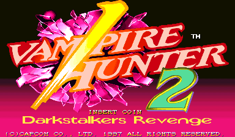
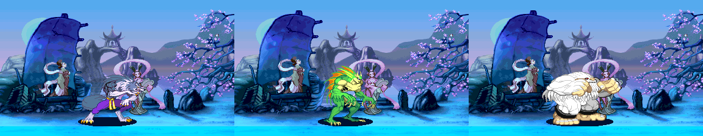
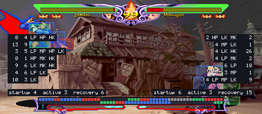

# Vampire Hunter 2 Recomp

> Part of **[CPS-2 Recomp](../../README.md)**: one download and one launcher for every CPS-2 game this
> project has ported. This page is about Vampire Hunter 2; the [main page](../../README.md) says how to
> download and play.

An unofficial native PC port of the arcade game *Vampire Hunter 2: Darkstalkers Revenge* (Capcom, 1997, CPS-2
board, Japan only) for macOS, Linux (Steam Deck included) and Windows, made by static recompilation, with a full
training mode.

Vampire Hunter 2 is **Night Warriors' cast on Vampire Savior's engine**: Donovan, Phobos (Huitzil), Pyron, Gallon,
Aulbath and Sasquatch with the others, and each fighter's own theme. It came out only in Japanese arcades, beside
[Vampire Savior 2](../vsav2/README.md), and was made from Vampire Savior's program: this port builds the same
sources as the [Vampire Savior port](../vampire_savior/README.md), so it has everything that one has.

> **Beta.** The game plays and its code is checked instruction by instruction, but nobody has played it by hand
> yet. Expect rough edges, and please [report what you find](#feedback-and-contributing).

**No game files are included.** You need your own copy of the game: the arcade ROM set `vhunt2` (Japan, 970929)
with its key file, from a board you own. This project cannot help you get one.

This project is not affiliated with, endorsed by, or sponsored by Capcom. *Vampire Savior* and *Darkstalkers* are
trademarks of Capcom Co., Ltd.





## What it is

The game's 68000 program is translated ahead of time into C++ and compiled into the port. The routines that
features touch (the camera, the stages, hit tests, the fight's rules) are Vampire Savior's readable rewrites, run
here where this game has them, with this game's own rules where they differ, and each is checked against this
game's own code on every call ([how it works](PROGRESS.md)). What the program expects of the board is code written
for this project, not an emulator.

- Plays with a keyboard, a gamepad or an arcade stick; every key and button can be changed, for
  each player, in the launcher.
- An in-game menu (Esc or `F1`; on a gamepad, the left stick's click or Start and Select together)
  with the training mode and the other modes, save states, speed, the cheats and every feature.
- The picture your way (Display page): sharp, whole pixels or smooth; 4:3, square pixels or the
  whole screen; and the window's size.
- **Rapid fire** (Game page): a button held down is pressed again and again, fifteen times a second, for the first
  button or for all of them; the first press is seen at once.
- **Pure** plays exactly as the board does. **Enhanced** (the default) adds free play and your own
  character colours. Every other feature is a switch of its own.
- The board's operator settings (difficulty, attack power, timer speed, game speed and the rest) on
  the Board page, each as the board is set unless you choose; or the game's own test menu from the in-game menu.
- **A custom soundtrack**: your own music in place of the board's, with the board's sound effects and voices: a
  folder of music plays as a playlist (in order or shuffled), or files named for the game's songs replace those
  songs (the `songs.txt` the game writes names its 61 pieces: each character's theme and win, the rival, Pyron, the
  ending). [How →](../../README.md#a-custom-soundtrack)
- Your ROM set is only ever read. Settings, save states and the board's settings memory go in your own user folder.

## The characters and stages

Fourteen characters: Demitri, Gallon, Victor, Zabel, Morrigan, Anakaris, Felicia, Bishamon, Aulbath, Sasquatch,
Lei-Lei, **Phobos, Pyron and Donovan**. Hidden on the board: Oboro Bishamon (Bishamon chosen with Start held), Shadow
(Start five times on the "?" box), Marionette (seven times), and another way of Phobos and of Donovan (Start held as
they are chosen). The **Hidden characters** switch (Game page) gives Dark Gallon for Gallon (he is in the game, but
no code on the board chooses him), Oboro Bishamon for Bishamon and Shadow for the "?" box, for player 1, player 2
or both, and to the alternative modes' fighters too.

Thirteen stages: Vampire Savior's twelve and **Donovan's**, Feast of the Damned's hall empty and darker. A fight
plays a fighter's own theme, as in Night Warriors; the stage viewer plays each stage's owner's (and Iron Horse's and
Fetus of God's, which are nobody's, the game's own music).

## Training mode

"Alternative modes" at the top of the in-game menu has a Training mode page: Start goes straight
to the character choice with two players and into a fight with no clock that nobody loses, and
the page holds the aids below.

| Feature | What it does |
| --- | --- |
| Hit boxes | The boxes the game itself tests: where a player can be hit (blue), attacks (red; orange for things thrown), and the boxes that keep the players apart (green) |
| Frame data and frame meter | Startup, active and recovery of each move and the advantage after a hit or a guarded hit, counted in the game's own steps; a row of coloured cells for each player, one a step |
| Input display | What each player presses and for how long, the stick as a keypad number |
| Combo readout | Hits, damage, how much is lost for good and how much comes back, the round's best |
| Health refills | A player's health comes back when they have not been hit for a moment |
| The dummy | Stands, crouches, jumps; guards (always, after a hit, at random; high or low as each attack needs); pushes away or guard cancels; softens throws; gets up where it fell or rolls towards or away; records and replays in three slots (one, or any at random), and can answer with a recording after guarding or being hit |
| Start over | The round as it began, in the middle or a corner, sides swapped or not (Backspace, or a gamepad's left shoulder) |
| Stage | Any of the thirteen stages, or the game's own choice |
| Stop, step, slow | Stop the game, go on one frame at a time, or play at a half, a quarter or an eighth of the speed (anywhere, not only in training) |

Also: save states in nine slots, free play, and a few cheats (no damage, one-hit knockouts, full
gauge, infinite time).



## Alternative modes

| Mode | What it does |
| --- | --- |
| Training mode | A fight with no clock that nobody loses, and the aids above |
| Attract mode | The game's own show on a loop, as a cabinet left alone plays it, with no coin to keep out |
| Stage viewer | Any of the thirteen stages with nobody on it and no panel, its own pieces moving and its music playing (or another stage's). Scroll it with the stick, or let it drift from end to end. "Infinite" is all thirteen in turn, each scrolling into the next |
| Model viewer | One character by itself, on a stage or on plain white or black, from a quarter of its size to 25 times, standing and moving with your controls or going through any of its animations, at full speed or in slow motion |
| Survival | One opponent after another on the health you have left. How many can you beat? |
| Endless battle | Two fighters the game plays, for as long as you like, with no bars and no clock, on one stage, on stages that fade one into another, or on a floor that scrolls through them all. Touch the controls to take a fighter over |
| Ring out | No health. Knock your opponent over the end of the stage (it is thrown back, as by a knock-down, and falls through the floor), then jump down after it and land on the next stage |
| Colour editor | Change a character's colours while you watch: custom colours, below |

## Widescreen

A switch on the launcher's first page, under "Full screen" (and on the in-game menu's Display page). Fights are
shown and played in 16:9: the picture is 512 columns wide where the board's is 384, at the same height and with
everything the same size, so there is a third more of the stage in view. Off unless you switch it on, because it
changes how the game plays (the players can stand further apart; the camera stops 64 short of where it did; a
stage's pieces and things thrown are kept while they are in the wide picture). The bars, the clock and the gauges
stay in the middle; the modes are wide too; everything that is not a fight keeps the board's 4:3.

**Invisible walls** (Display page) keeps the 16:9 picture and plays the game exactly as the board does: the players
are stopped where the board's picture ends, by walls that are not seen.

## Custom colours

Give any character colours of your own, with the game's colour editor (on the in-game menu's "Alternative modes"
page: the character in front of you, any of their ten colour sets, 16 levels each of red, green and blue, random
colours, a library of saved sets) or with text files, one a character, in the `palettes` folder. (PalMod's ROM file
does not work in this game: its colours run over from one program file into the next.) To play in them, choose the
character with the button of the set you changed. It works as in Vampire Savior, whose page has the
[whole story](../vampire_savior/README.md#custom-colours); the folder is:

| System | Folder |
| --- | --- |
| Windows | `%APPDATA%\Vampire Hunter 2\palettes` |
| macOS | `~/Library/Application Support/Vampire Hunter 2/palettes` |
| Linux, SteamOS | `~/.local/share/Vampire Hunter 2/palettes` |

## What you need

- The ROM set `vhunt2` (*Vampire Hunter 2: Darkstalkers Revenge*, Japan 970929): `vhunt2.zip` or a folder with the
  set's files, including `vhunt2.key`. (The earlier revision, 970913, is not taken.) The launcher checks every file by checksum and tells you which is missing or
  different.
- One of: macOS 13 or later (Apple silicon or Intel); Linux x86_64 or SteamOS; Windows 10 or 11, 64-bit.
- A gamepad or stick with six buttons is recommended.

## Playing

Vampire Hunter 2 comes with [CPS-2 Recomp](../../README.md#playing): open its launcher and show it your ROM set
(drop `vhunt2.zip` or its folder on the window, or choose the folder you keep your sets in), then press **Play**
beside Vampire Hunter 2. From a terminal, `cps2recomp-launcher --play vhunt2` starts it straight away; the game's own
program (`vhunt2`, beside the launcher) runs by itself too: `vhunt2 --help` lists what it takes.

## Building from source

With your own ROM set in `rom/vhunt2/` (ignored by Git), from the repository's top:

```sh
make GAME=vhunt2            # twice the first time
make GAME=vhunt2 explore    # once: finds the game's code by made-up play and translates it
make GAME=vhunt2 run
make GAME=vhunt2 check-rewrites check-widescreen
```

The sources are Vampire Savior's (`games/vampire_savior/src`); `family.h` here says where their places are in this
game and what is its own, and [PROGRESS.md](PROGRESS.md) what was found. [docs/BUILDING.md](../../docs/BUILDING.md)
has every platform.

## Feedback and contributing

Bug reports and pull requests are welcome: see [CONTRIBUTING.md](../../CONTRIBUTING.md) for the rules (above all:
nothing from the game, ever).

## License and credits

GPL-3.0-only (see [LICENSE](../../LICENSE)); [THIRD_PARTY_NOTICES.md](../../THIRD_PARTY_NOTICES.md) lists what comes
from other projects. The repository holds no game data: the places `family.h` lists are numbers, as the names
headers' are.
