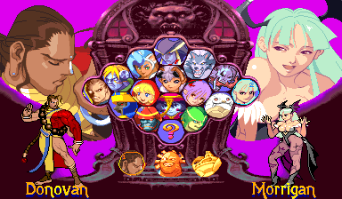

# Vampire Savior Definitive: what it is for and how it works

This page is for whoever wants to know why this game exists and how it is put together, to fix it or to take
something else into it the same way. How to play it is on its [README](README.md).

## Why

*Vampire Savior* (1997) left out three of the series' characters: Donovan, Phobos (Huitzil) and Pyron. Capcom put
them back the same year in *Vampire Savior 2*, made from Vampire Savior's program, but that game also changed the
game for everyone else and dropped three others, and players kept to the first game. The Japanese set `vsavj`
(970519) is the one played competitively to this day.

So the game players would call definitive is that one, with all eighteen characters: Vampire Savior's engine and
rules, and the three as Vampire Savior 2 has them. Not a remix, not a new balance: each character as Capcom made
it, in the version of the engine the players chose. Where Vampire Savior 2's engine treats the three differently
from everyone else, that difference comes with them; what it changed for everyone stays out.

Two rules follow from that, and every part of this game keeps them:

- **Vampire Savior is unchanged.** Nothing taken in changes what the fifteen characters do. The game with none of
  the three chosen plays exactly as the [Vampire Savior port](../vampire_savior/README.md), state for state (its
  regression runs give the same hashes, every frame).
- **The three are Vampire Savior 2's own.** Their moves, animations, boxes, colours and voices are not redrawn or
  rewritten: they come from that game's program, graphics and sound, run as it runs them.

## The parts

| Part | What it does |
| --- | --- |
| `game.cfg` (`extra_set`) | The second ROM set, Vampire Savior 2's, mapped where the board has nothing, from A00000 |
| `graft.cfg` and `tools/graft.py` | Vampire Savior's tables by character get the three's entries, taken from Vampire Savior 2's same tables |
| `src/graft.cpp` | Patches in what `graft.py` made; the hooks behind the kinds of entry a table can't just hold |
| `src/rules.cpp` | The places where Vampire Savior 2's engine does something for the three that this one doesn't |
| `src/choosing.cpp` | The character choice: the three's places, a row under the grid, and their faces |
| `machine/sound_board.h` | A second sound side, with Vampire Savior 2's sound program and samples |
| `family.h` | The family's shared sources (`games/vampire_savior/src`): where the places they name are in this game |

### Two programs, one 68000

Vampire Savior's program is translated to C++ ahead of time, as every game in this project is. Vampire Savior 2's
program is not: it is mapped at A00000 and its code runs on the interpreter, called from the translated code. When
one of the three is on screen, part of every frame is Vampire Savior 2's code, running as it would on its own board.

What that code names has to be where this game has it. Its routines, variables and tables are at other addresses
in Vampire Savior, so:

- **Pointers it loads** (`movea.l` from its tables, which hold its own addresses) are moved to A00000 on (the
  68000's `PointerLoad`, `MemPointer` in the rewrites), so its pictures and data are read from its set.
- **Its variables** are where Vampire Savior keeps the same ones. The few it has and this game has not are put in
  work memory this game never uses (`graft.cfg`: `ram`).
- **Its routines** are this game's, where this game has the same one (`graft.py` finds the place by comparing the
  two programs; `graft.cfg` names the ones it can't find).

### Tables by character

Vampire Savior's code reads hundreds of tables by character number: animations, boxes, speeds, sounds, palettes,
throws, and so on. Each has entries for Vampire Savior's characters only, and the three are numbers 10, 11 and 13,
past the end. `graft.cfg` lists every such table (about 120) with where it is read; `graft.py` finds the same table in
Vampire Savior 2 and builds the three's entries from it:

- `table`: an entry by kind (a number, a routine's address, a table's address, a whole record, a jump or offset
  table), translated to this game's places where it names code.
- `extend`: a table indexed by something Vampire Savior 2 has more of than Vampire Savior (an attack's kind, a
  picture's kind), given its extra entries.
- `mask`: a bit mask by character number, taken from Vampire Savior 2's for the three.
- `divert`: where Vampire Savior 2's engine has a different path for the three (it compares the character number),
  the three go on in its code from that place; everyone else stays in this game's.
- `patch`: a few bytes changed where neither way fits.

The generated header (`work/vsav_definitive/gen/graft_data.h`) is made from both ROM sets at build time and is
never kept in the repository: it holds the games' data.

Missing tables are the usual cause of trouble: a character reading past the end of a table gets whatever is there.
So `graft.cfg` was checked with a full scan, every table read after a character's number, not only the first.

### Engine rules for the three

Some differences are not tables but code: Vampire Savior 2 compares against Donovan, Phobos or Pyron in places
Vampire Savior's code has no such test. `src/rules.cpp` has a hook for each, with the address there in its
comment: Jedah's move against Donovan, the reactions to one kind of attack, the height of things put on an
opponent, Pyron's attached effects, their palettes on the versus and talk screens, the arcade's winner and its
ending (Vampire Savior 2's staff roll), thrown things of the types Pyron uses.

### Pictures and sound

The board draws objects and scroll tiles from its graphics ROMs. Here there are two sets of graphics, and each
object is drawn from Vampire Savior 2's when that game's program was read just before the object was written
(`Machine::ObjectWritten`; scroll tiles the same way). A picture read from its set is drawn from its graphics,
whatever code draws it, so their animations need nothing more.

Their voices and sounds are requests to Vampire Savior 2's own sound program, on a second sound side with its
samples. The two sides are mixed, so both games' sounds play together.

### The character choice

The grid is Vampire Savior's: a place for each of its characters and one for a random choice. The three have
places of their own, a row under it. A place's number is its character's (the game's choice code makes the place
chosen the character), so theirs are numbered as the three are (13, 11 and 10), and whatever is read by character
(the big portrait, the figure and the name beside the grid) follows by itself, from the tables above.

What reads the place is in `src/choosing.cpp`:

- **The cursor's moves.** The game moves the cursor by a table of each place's next place in eight directions.
  The hook answers for theirs (left and right along the row, up into the grid) and for down from the three places
  above them; every other move is the game's own.
- **The cursor's ring.** The ring's position and picture come from tables by place. At theirs, it is the random
  choice's ring (a place of the same size), moved to theirs. Player 2's ring, and the one for both players on a
  place, work the same way.
- **Their faces.** The grid's faces are one picture of them all. At the end of its drawing, the hook puts three
  more objects, Vampire Savior 2's faces, drawn from its graphics, in palettes the screen leaves free (put after
  everything else that frame, since a figure beside the grid may change the palettes next to its own). Vampire
  Savior 2 arranges its grid differently, so their places were set by eye.

The random choice is still Vampire Savior's fifteen.

### The launcher

The launcher passes `--rom2` with the set chosen on Vampire Savior 2's page (`Launch::file_of` in recomp-common),
so the player picks each set once.

## How it was checked

- Vampire Savior's regression runs (versus, the arcade ladder, training, the viewers, the hidden characters) give
  the same state hashes every frame, after every change.
- Every rewritten routine checked call by call against the game's own code, with the three playing, with the
  expected differences only.
- In the model viewer, each of the three's animations picture for picture against Vampire Savior 2.
- Arcade runs to the ending as each of the three; training fights between all eighteen; each of the three in the
  endless battle against every other character, 12,000 frames each.

## Not yet

- Donovan's stage (Vampire Savior 2's thirteenth). Vampire Savior's twelve stages are all here.
- Vampire Savior 2's music for the three.

Both are possible the same way: the stage is another table set and its scroll layers from the extra graphics; the
music would play on the second sound side.

## Taking in more

Another family game's characters (Vampire Hunter 2's, say) would go in the same way: a `character` line, its
tables (every read by character number, found with a full scan), its rules found by comparing where the other
game tests the new numbers, and a place for it at the choice. The two rules above still hold: the base
game unchanged, the newcomer as its own game made it.
