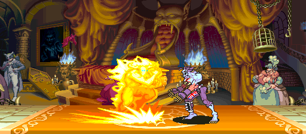
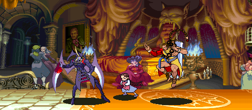
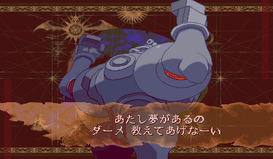

# Vampire Savior Definitive

> Part of **[CPS-2 Recomp](../../README.md)**: one download and one launcher for every CPS-2 game this
> project has ported. This page is about Vampire Savior Definitive; the [main page](../../README.md) says how to
> download and play.

Vampire Savior Definitive is *Vampire Savior: The Lord of Vampire* (Capcom, 1997, the Japanese set the game's
players hold as its standard) with the three characters only [Vampire Savior 2](../vsav2/README.md) has:
**Donovan, Phobos (Huitzil) and Pyron**, taken from that game's own program, pictures and sounds. Vampire
Savior's fifteen stay, so all eighteen are there, and every one plays by Vampire Savior's rules, as if the three
had always been in it. It has everything the [Vampire Savior port](../vampire_savior/README.md) has: the training
mode and the dummy, widescreen, the modes, custom colours, the board's settings and the rest.

> **Beta.** The three play, and what they do is checked against Vampire Savior 2 (every animation picture for
> picture in the model viewer, every rewritten routine of the game against its own code), but nobody has played
> them by hand yet. Expect rough edges, and please [report what you find](#feedback-and-contributing).

**No game files are included.** You need your own copies of both games: the arcade ROM sets `vsavj` (Japan 970519)
and `vsav2` (Japan 970913), each with its key file, from boards you own. This project cannot help you get them.

This project is not affiliated with, endorsed by, or sponsored by Capcom. *Vampire Savior* and *Darkstalkers* are
trademarks of Capcom Co., Ltd.


## Choosing them

At the character choice, **Donovan, Pyron and Phobos have places of their own: a row under the grid**, below
the random choice. Move down from the bottom of the grid to reach them, as to any other place, with their
picture, figure and name beside the grid. Dark Gallon is still Start held with two punches or two kicks on
Gallon's place.


The in-game menu's **Definitive** page can also make either player one of the three at the next character
choice, whatever is chosen there, and the training mode, the model viewer and the modes have them as they have
everyone.

## What they bring

- Their moves, specials and supers, from Vampire Savior 2's code, with what its engine does differently for them
  (where it compares their numbers) done the same here.
- Their pictures and colours from Vampire Savior 2's graphics, in the fight, the versus screen, the character
  choice, the arcade's talks and the model viewer; custom colours and the colour editor for them too.
- Their voices and their own sounds, played by Vampire Savior 2's own sound program and samples beside Vampire
  Savior's, heard together.
- The arcade with any of them to its end, which is Vampire Savior 2's: its staff roll.


| | |
| --- | --- |
|  |  |
|  | |

Not yet: Donovan's stage and Vampire Savior 2's music (Vampire Savior's twelve stages are all here).

## What you need

- Both ROM sets: `vsavj` (*Vampire Savior: The Lord of Vampire*, Japan 970519) and `vsav2` (*Vampire Savior 2: The
  Lord of Vampire*, Japan 970913), each as a zip or a folder of its files, with its key file. In the launcher,
  choose `vsavj` on this game's page and `vsav2` on Vampire Savior 2's: this game takes it from there.
- One of: macOS 13 or later (Apple silicon or Intel); Linux x86_64 or SteamOS; Windows 10 or 11, 64-bit.

## Playing

Vampire Savior Definitive comes with [CPS-2 Recomp](../../README.md#playing). From a terminal, `vsav_definitive
--rom <vsavj> --rom2 <vsav2>` starts it straight away (without `--rom2`, `vsav2` is looked for beside `vsavj`).

## How it works

Vampire Savior's program is translated and built as the Vampire Savior port is, and Vampire Savior 2's program is
mapped where the board has nothing (from A00000), so its code for the three runs as it is, on the interpreter. What
it names (Vampire Savior 2's routines, variables and tables) is moved to where this game has them, and Vampire
Savior's tables by character get the three's entries ([graft.cfg](graft.cfg), made into code by `tools/graft.py`
from both programs: never kept in the repository). [src/rules.cpp](src/rules.cpp) has the few places where Vampire
Savior 2's engine treats them otherwise, and `divert` lines send them into its own code there.
[DEFINITIVE.md](DEFINITIVE.md) has the whole of it: what this game is for, the rules it keeps, and each part.

## Building from source

With both sets in `rom/vsav_definitive/` (`vsavj`'s files) and `rom/vsav2/`, from the repository's top:

```sh
make GAME=vsav_definitive
make GAME=vsav_definitive run
```

## Feedback and contributing

Bug reports and pull requests are welcome: see [CONTRIBUTING.md](../../CONTRIBUTING.md) for the rules (above all:
nothing from the game, ever).

## License and credits

GPL-3.0-only (see [LICENSE](../../LICENSE)); [THIRD_PARTY_NOTICES.md](../../THIRD_PARTY_NOTICES.md) lists what comes
from other projects. The repository holds no game data.
